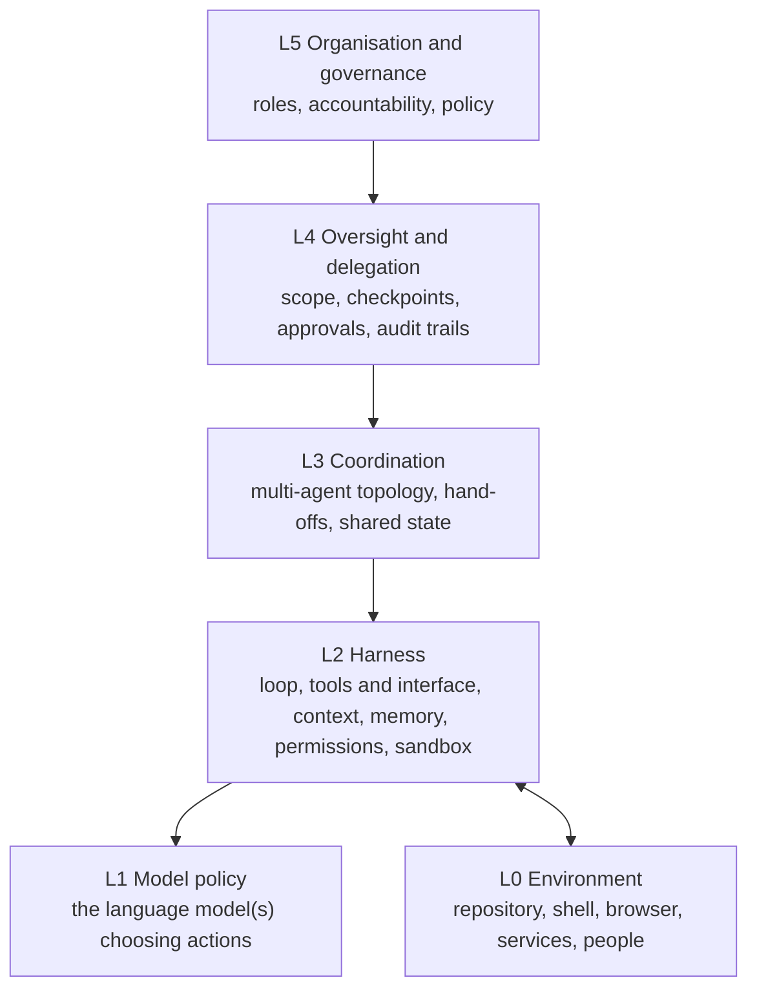

# Chapter 01: A Proposed Definition and Taxonomy of AI Agent Engineering

*AAE Research Notebook v0.1, 2026-10-14. Not peer reviewed.*

> **Status of this chapter: [OP], our proposal.** Everything in this chapter that defines, classifies, or names is a proposal by the AAE notebook. It is offered so that it can be criticised, tested, and replaced. Where we build on established work, we cite it and tag the cited claim with its own evidence class.

## 1. Why propose a definition at all?

A definition is useful only if it changes what people do: what they measure, what they report, and what they consider a contribution. We propose one for three practical reasons.

1. **Reporting.** Agent papers and practitioner reports routinely omit the information needed to compare them: the action space, the context policy, the verification signals available to the agent, the budget, and where humans intervened. SWE-agent's ablations show that interface choices alone moved SWE-bench Lite resolve rates by several percentage points [@yang2024sweagent] **[PR]**, and OpenAI observed that GPT-4's SWE-bench Lite score varied between 2.7% and 28.3% depending on the scaffold [@chowdhury2024sweverified] **[VC]**. If the harness matters that much, it has to be reported as part of the result.
2. **Separation of concerns.** Model capability, harness design, and evaluation methodology are entangled in most reported numbers. A discipline-level vocabulary helps separate them.
3. **Accumulation.** Without shared terms, findings about, for example, context truncation in coding agents and memory in simulation agents are not recognised as findings about the same design problem.

## 2. Proposed definition [OP]

> **AI Agent Engineering (AAE)** is the systematic study and practice of designing, building, verifying, evaluating, operating, and governing systems in which one or more AI models select and execute actions in an environment over multiple steps toward a goal, with the purpose of making such systems *reliably useful, verifiably correct within stated bounds, and safe to delegate to*.

### 2.1 Unpacking the definition

- **"Systematic study and practice"**: AAE is meant as both a research field and an engineering practice, like software engineering. It is not a product category.
- **"Select and execute actions … over multiple steps"**: this is the boundary condition. A single model call, even with retrieval, is not an agent in this sense. A fixed pipeline of model calls (a *workflow* in Anthropic's terminology [@anthropic2024effective] **[VC]**) is a boundary case: it belongs to AAE when it is designed as an alternative to an agent, as Agentless was [@xia2025agentless] **[PR]**, because the comparison is itself an AAE question.
- **"In an environment"**: the effects are real or simulated state changes, not only text.
- **"Reliably useful, verifiably correct within stated bounds, and safe to delegate to"**: these are the three quality goals. *Reliability* concerns variance across runs and conditions. *Verifiability* concerns whether correctness can be established and by whom. *Delegability* concerns whether a human can responsibly hand the task over.

### 2.2 What AAE is not

- **Not prompt engineering.** Prompts are one artefact of the harness. AAE also covers interfaces, tools, memory, permissions, verification, evaluation, and operations.
- **Not ML engineering.** AAE usually treats the model as a component with given capabilities. Training is relevant when it targets agent behaviour (e.g., SWE-Gym trains agents and verifiers from environment interaction [@pan2025swegym] **[PR]**), but it is not the centre of AAE.
- **Not the classical multi-agent systems field.** Multi-agent systems research [@wooldridge1995intelligent] **[PR]** is an important ancestor. AAE is specifically concerned with agents whose policy is a pretrained language model whose behaviour is shaped mostly through context and interfaces rather than through explicit programming.

### 2.3 Relation to neighbouring terms

| Term | Origin | Relation to AAE (our reading) [OP] |
|---|---|---|
| Agentic Software Engineering / SE 3.0 | SE research community [@hassan2025agenticse] **[PP]**, [@hassan2026se3] **[PR]** | ASE is AAE applied to software engineering, and also SE adapting itself to agents ("SE for Agents"). We adopt the term, not invent it. |
| Harness engineering | Recent agent-systems reviews [@zhou2026externalization] **[PP]**, [@guo2026harness] **[PP]** | A core sub-area of AAE (layer L2 below). |
| Language agents / cognitive architectures | [@sumers2024coala] **[PR]** | Provides the architectural vocabulary we use for L1 and L2. |
| LLM-based autonomous agents | Survey literature [@wang2024survey] **[PR]** | Overlapping object of study; surveys focus on capabilities and applications, AAE on engineering practice and evidence. |

## 3. Proposed taxonomy [OP]

We organise AAE along two orthogonal dimensions: **layers** of the system being engineered, and **lifecycle activities** applied to it. A third dimension, **application domain**, determines which verification signals are available.

### 3.1 Dimension A: system layers

| Layer | Engineering object | Example established work |
|---|---|---|
| **L0 Environment** | What the agent acts on and observes; sandboxes; reproducible environments | Containerised SWE-bench harness [@chowdhury2024sweverified] **[VC]**; synthesised training environments [@pan2025swegym] **[PR]** |
| **L1 Model policy** | The model's action-selection behaviour as shaped by prompting or fine-tuning | ReAct prompting [@yao2023react] **[PR]**; CodeActInstruct fine-tuning [@wang2024codeact] **[PR]** |
| **L2 Harness** | Loop, action space, tool interfaces, context construction, memory, permissions | Agent-computer interface [@yang2024sweagent] **[PR]**; MemGPT memory tiers [@packer2023memgpt] **[PP]**; MCP [@mcp2026spec] **[VC]** |
| **L3 Coordination** | Multiple agents, roles, communication, shared artefacts | ChatDev [@qian2024chatdev] **[PR]**; MetaGPT [@hong2024metagpt] **[PR]**; AutoGen [@wu2023autogen] **[PR]** |
| **L4 Oversight and delegation** | Where humans approve, review, or intervene; evidence handed to humans | ACE/AEE workbenches proposed in [@hassan2025agenticse] **[PP]**; practitioner decision logs [@tan2026pstack] **[EE]** |
| **L5 Organisation and governance** | Team processes, accountability, policy, regulation | Agentic project-management vision [@assalaarachchi2026agenticpm] **[PUB]** |

The layering is a proposal. Its claim is that design decisions at each layer can be studied somewhat independently, and that a reported result should state the configuration of every layer.

### 3.2 Dimension B: lifecycle activities

1. **Specification**: stating the goal and the *done predicate*, i.e., the observable condition that ends the task. **[OP]** We hypothesise that the quality of the done predicate is among the largest controllable factors in agent outcomes. This is untested; see Q3 in the agenda.
2. **Design**: choosing the architecture at each layer (Chapter 03).
3. **Construction**: implementing tools, interfaces, context policies, and instruction files.
4. **Verification**: establishing that a particular run's output meets the specification. This is distinct from evaluation.
5. **Evaluation**: estimating how a configuration performs across a distribution of tasks. It includes benchmark design and benchmark auditing [@chen2026oracle] **[PP]**, [@ding2026reexec] **[PP]**.
6. **Operation**: running agents over time, including monitoring, cost control, incident handling, and maintenance of the harness itself [@giampieri2026cortex] **[PP]**.
7. **Governance**: permissions, security, auditability, and accountability [@liao2026skillrelay] **[PP]**, [@trong2026misbehavior] **[PP]**.

The distinction between **verification** (this output, now) and **evaluation** (this configuration, in general) is, we think, the most important one in the taxonomy **[OP]**. Much confusion in practice comes from treating a benchmark score as a verification of a particular change, or from treating one successful run as evidence about a configuration.

### 3.3 Dimension C: application domain and its verification profile

Domains differ in how strong and how available their verification signals are. We propose characterising each domain by a **verification profile** **[OP]**:

| Domain | Typical signals | Strength | Agent can obtain itself? |
|---|---|---|---|
| Software engineering (ASE) | compilers, type checkers, tests, linters, reproduction scripts, running the application | Medium to high, but tests can be weak or over-specific [@aleithan2024swebenchplus] **[PP]** | Often yes |
| Data analysis | recomputation, invariants, cross-checks | Medium | Often yes |
| Web and GUI tasks | page state, screenshots, task-specific checkers | Low to medium | Partially |
| Customer-facing dialogue | policy rules, user satisfaction, database end state | Low to medium [@yao2024taubench] **[PR]** | Rarely |
| Research and writing | source verification, peer review | Low, slow | Partially |

**Hypothesis H1 [OP].** Agent reliability in a domain is bounded by the strength and availability of its verification signals more than by model capability alone. ASE is the natural starting domain because its profile is comparatively strong. This hypothesis is consistent with, but not established by, SWE-agent's finding that an editing guardrail (a linter that blocks syntactically invalid edits) improved performance [@yang2024sweagent] **[PR]**.

### 3.4 Cross-cutting quality attributes

For each layer and activity we propose evaluating against five attributes **[OP]**: **effectiveness** (task success), **reliability** (variance across seeds, runs, and environments), **verifiability** (strength of evidence produced for a human), **efficiency** (cost, latency, human attention consumed), and **safety and security** (boundary adherence, resistance to injected instructions, reversibility of actions).

## 4. Using the taxonomy: a reporting checklist [OP]

We propose that any report of an agent result, whether a paper, a vendor post, or a case study in this notebook, state:

1. **L0**: environment, isolation, and how it was reset between tasks.
2. **L1**: model identifiers and versions, sampling settings, number of runs.
3. **L2**: action space, tool list, context policy (truncation, summarisation, retrieval), memory, step and cost budgets.
4. **L3**: number and roles of agents, communication pattern.
5. **L4**: where humans intervened, and whether any human information leaked into the run.
6. **Verification signals** available to the agent versus signals used for scoring.
7. **Evaluation**: benchmark version and split, known validity issues, and whether results were re-executed.

The SWE-agent paper reports most of these items for its own experiments (model versions, $4 per-instance budget, history handling, interface ablations) [@yang2024sweagent] **[PR]**; it is a useful model for the checklist.

## 5. Falsifiability of the AAE proposal

If AAE is a useful framing, the following should hold. We list them so that evidence can count against the proposal.

- **F1.** Harness design principles found in ASE (e.g., compact, guarded interfaces) transfer measurably to at least one other domain. *Counter-evidence:* domain-specific interface findings that fail to transfer.
- **F2.** Reporting the full layer configuration improves reproducibility of agent results. *Counter-evidence:* results that are equally irreproducible with full reporting.
- **F3.** The verification/evaluation distinction predicts practical failures, e.g., teams that conflate them ship more regressions. *Counter-evidence:* no difference.
- **F4.** As models improve, harness effects shrink but do not vanish. *Counter-evidence:* harness effects disappear entirely, which would reduce AAE to model selection. Cortex's observation that a single run's harness changes "added little" under a stronger model is a weak early data point in this direction, with an n of one repository [@giampieri2026cortex] **[PP]**.

## 6. Limitations

The taxonomy is derived from a narrative review centred on software engineering. It has not been validated by card sorting, expert elicitation, or application to a corpus of papers. The layer boundaries (especially L2 versus L3, and L4 versus L5) are fuzzy in real systems. A systematic mapping study that classifies a sample of agent papers into this scheme, and measures inter-rater agreement, is the obvious next step (agenda, Q10).

## References

Keys cited (all in [`references.bib`](../references.bib)): `yang2024sweagent`, `chowdhury2024sweverified`, `anthropic2024effective`, `xia2025agentless`, `pan2025swegym`, `wooldridge1995intelligent`, `hassan2025agenticse`, `hassan2026se3`, `zhou2026externalization`, `guo2026harness`, `sumers2024coala`, `wang2024survey`, `yao2023react`, `wang2024codeact`, `packer2023memgpt`, `mcp2026spec`, `qian2024chatdev`, `hong2024metagpt`, `wu2023autogen`, `tan2026pstack`, `assalaarachchi2026agenticpm`, `chen2026oracle`, `ding2026reexec`, `giampieri2026cortex`, `liao2026skillrelay`, `trong2026misbehavior`, `aleithan2024swebenchplus`, `yao2024taubench`.
