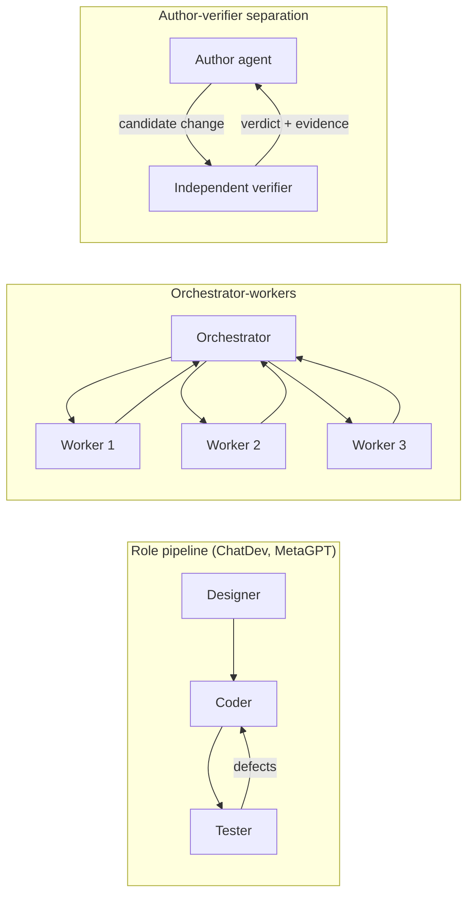
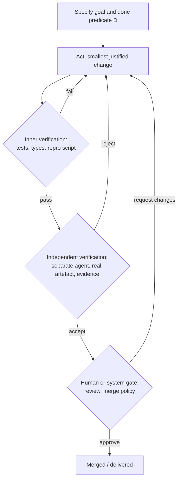
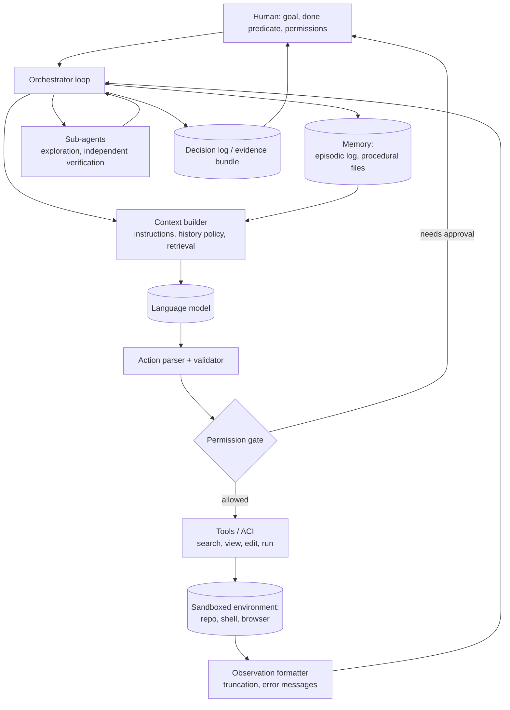

# Chapter 03: Agent Architectures

*AAE Research Notebook v0.1, 2026-10-14. Not peer reviewed.*

This chapter is a technical treatment of how LLM agents are structured: the execution loop, interleaved reasoning and acting, planning and decomposition, tool use and interfaces, memory and context, multi-agent setups, and verification loops. Formal notation is ours **[OP]** unless a source is cited for it; we use it to make the design choices explicit, not to claim theorems. Each section ends with the main limitations.

## 1. A minimal formal model of the agent loop

### 1.1 Notation [OP]

Let $g$ be a goal (task description), $\mathcal{A}$ an action space, and $\mathcal{O}$ an observation space. At step $t$ the agent holds a history

$$h_t = (g, a_1, o_1, \ldots, a_{t-1}, o_{t-1}).$$

A language model $M$ does not consume $h_t$ directly. The harness builds a **context** $c_t = C(h_t, m_t)$ from the history and from an external memory $m_t$, under a token budget $B$:

$$|c_t| \le B.$$

The model samples an output $y_t \sim M(\cdot \mid c_t)$, which a parser $P$ maps to an action $a_t = P(y_t) \in \mathcal{A}$ (or to an error). The environment $E$ executes it and returns an observation, possibly changing its state $s$:

$$(o_t, s_{t+1}) = E(s_t, a_t).$$

The loop terminates when a **done predicate** $D(h_t, s_t) \in \{\text{true}, \text{false}\}$ holds, or when a budget (steps, tokens, cost, wall-clock time) is exhausted.

This decomposition makes the engineering surface visible. In a typical system the model $M$ is fixed by the provider. Everything else ($C$, $m$, $P$, $\mathcal{A}$, the implementation of $E$'s interface, $D$, and the budgets) is designed by the engineer. That is the **harness** in the sense of Chapter 00, §3.3.

### 1.2 Reference pseudocode

```python
def run_agent(goal, env, model, budget):
    history = [goal]
    memory = Memory()
    for step in range(budget.max_steps):
        context = build_context(history, memory, budget.max_tokens)   # C
        output = model.generate(context)                               # M
        action = parse_action(output)                                  # P
        if action is None:
            history.append(Observation("Could not parse an action; use the documented format."))
            continue
        if not permitted(action):                                      # permission layer
            history.append(Observation(f"Action {action.name} requires approval."))
            continue
        observation = env.execute(action)                              # E
        history.append((output, action, observation))
        memory.update(action, observation)
        if done(history, env):                                         # D
            return Result(success=True, history=history)
        if budget.exhausted(history):
            break
    return Result(success=False, history=history)
```

Every line other than `model.generate` is a design decision with published evidence or open questions attached. Anthropic's description of agents as "typically just LLMs using tools based on environmental feedback in a loop" [@anthropic2024effective] **[VC]** is accurate as a description of this skeleton, and misleading if it suggests the remaining lines are trivial.

### 1.3 Termination is a design choice

Three termination styles appear in practice:

1. **Model-declared**: the model emits a `finish` or `submit` action. This is cheap but trusts self-report. AgentSWE documents "unsupported claims of completion" as a recurring failure mode [@wang2026agentswe] **[PP]**.
2. **Harness-checked**: the harness evaluates an executable predicate (tests pass, reproduction script no longer fails). This is stronger, but only as strong as the predicate.
3. **Externally reviewed**: a separate verifier, a second model, or a human decides.

**[OP]** We recommend reporting which style a system uses, because it changes what a "success" means.

## 2. Reasoning and acting: ReAct and its relatives

### 2.1 The ReAct pattern

ReAct augments the action space with free-text "thoughts" that do not affect the environment [@yao2023react] **[PR]**. In our notation, the agent's output space is $\hat{\mathcal{A}} = \mathcal{A} \cup \mathcal{L}$, where $\mathcal{L}$ is language. A thought $\hat{a}_t \in \mathcal{L}$ produces no observation; it only extends the context. The authors describe the purpose of reasoning traces as helping the model "induce, track, and update action plans as well as handle exceptions", while actions let it gather information from external sources [@yao2023react] **[PR]**.

A ReAct trajectory therefore looks like:

```
Thought: I need to find where the parser handles empty input.
Action:  search_dir("def parse", "src/")
Obs:     src/parser.py:41: def parse(text): ...
Thought: The guard on line 45 returns None instead of raising.
Action:  open("src/parser.py", 41)
...
```

### 2.2 What ReAct established, and what it did not

With PaLM-540B and only one to six in-context examples, ReAct outperformed acting-only prompting on HotpotQA and Fever. On the interactive benchmarks ALFWorld and WebShop it outperformed imitation and reinforcement learning baselines by 34 and 10 absolute percentage points of success rate [@yao2023react] **[PR]**. Two less-quoted findings matter more for engineering:

- **ReAct was not uniformly better than chain-of-thought.** On HotpotQA, ReAct scored 27.4 EM versus 29.4 for CoT. The best results came from *combining* ReAct with CoT self-consistency, with heuristics for switching between them [@yao2023react] **[PR]**.
- **The failure modes are loop-specific.** In a manual analysis of HotpotQA trajectories, ReAct exhibited a characteristic error of repeating its previous thoughts and actions, and non-informative search results accounted for 23% of its error cases [@yao2023react] **[PR]**.

See [papers/react.md](../papers/react.md) for the full annotation.

### 2.3 Self-feedback and reflection

- **Reflexion** adds an outer loop across *trials*: after a failed attempt, the model writes a verbal reflection on the feedback signal, which is stored in an episodic memory buffer and included in the next attempt's context [@shinn2023reflexion] **[PR]**. Formally, if $\tau^{(k)}$ is the $k$-th trial trajectory and $r^{(k)}$ its feedback, the memory evolves as $m^{(k+1)} = m^{(k)} \cup \{\text{reflect}(\tau^{(k)}, r^{(k)})\}$. Reflexion reported 91% pass@1 on HumanEval [@shinn2023reflexion] **[PR]**.
- **Self-Refine** iterates generate, critique, and refine within one task using the same model [@madaan2023selfrefine] **[PR]**.

**Limitation.** Both depend on the quality of the feedback signal. Reflexion's coding results use test-based feedback, and the model's own written tests can be wrong. When the signal is weak, reflection can reinforce errors **[OP, hypothesis]**.

## 3. Planning and decomposition

### 3.1 Spectrum of planning strategies

| Strategy | Mechanism | Representative source |
|---|---|---|
| Implicit, step-wise | Plan is formed and revised inside reasoning traces at each step | ReAct [@yao2023react] **[PR]** |
| Decompose then solve | Break the problem into ordered subproblems, solve sequentially | Least-to-most [@zhou2023leasttomost] **[PR]** |
| Search over thoughts | Generate several candidate thoughts, evaluate them, expand with BFS/DFS, backtrack | Tree of Thoughts [@yao2023tree] **[PR]** |
| Designer-fixed phases | The engineer fixes the phases, and the model works within each | Agentless [@xia2025agentless] **[PR]**; prompt chaining [@anthropic2024effective] **[VC]** |
| Orchestrator–workers | A coordinating model decomposes dynamically and delegates | Anthropic's orchestrator-workers pattern [@anthropic2024effective] **[VC]** |

### 3.2 Search as planning

Tree of Thoughts makes the search explicit. Given a state $x$ consisting of the problem and the partial thoughts, a generator proposes $k$ candidate thoughts, and an evaluator $V(x) \in \mathbb{R}$ (or a vote) scores states, which are then expanded by breadth- or depth-first search. In Game of 24, GPT-4 with chain-of-thought solved 4% of tasks versus 74% with ToT [@yao2023tree] **[PR]**. The cost is many more model calls per task.

In software engineering the analogue of search is usually **sampling several candidate patches and selecting among them**, using tests, reproduction scripts, or a learned verifier [@xia2025agentless] **[PR]**, [@pan2025swegym] **[PR]**. Selection quality is bounded by verifier quality: if $V$ is a test suite with false positives, more samples increase the chance of selecting a wrong patch that passes. **[OP]** We expect the gain from best-of-$n$ selection to saturate at a level set by verifier precision. This is a testable hypothesis (agenda, Q4).

### 3.3 When to plan up front

Upfront plans help when tasks decompose cleanly and subtasks are predictable; step-wise planning helps when the environment reveals information progressively, as in debugging. Anthropic recommends fixed workflows when subtasks are predictable and agents when "it's difficult or impossible to predict the required number of steps" [@anthropic2024effective] **[VC]**. Agentless's competitive results on SWE-bench Lite suggest that, for issue resolution, a large part of the task *is* predictable (localise, repair, validate) [@xia2025agentless] **[PR]**.

**Limitations.** Planning results in the literature are mostly on puzzles, QA, and short benchmarks. How plan quality relates to outcomes in long-horizon repository work is poorly measured. Time-horizon results show capability growth but do not isolate planning [@kwa2025horizon] **[PR]**.

## 4. Tool use and the agent-computer interface

### 4.1 Representing actions

Three representations dominate:

1. **Structured calls** (JSON function calls against a schema). They are easy to validate and permission, but composition across tools takes several turns.
2. **Code actions**: the model writes executable code that calls tools. CodeAct reported up to 20% higher success than text or JSON formats on API-Bank and a new benchmark, across 17 LLMs [@wang2024codeact] **[PR]**. This form is more expressive but harder to sandbox and permission.
3. **Shell commands**: maximally general. SWE-agent found that a raw Linux shell was a weaker interface than a purpose-built one [@yang2024sweagent] **[PR]**.

Toolformer is distinct in that the model *learns* when to call tools during training, rather than being prompted to [@schick2023toolformer] **[PR]**.

### 4.2 Interface design as an engineering variable

SWE-agent's ablations on SWE-bench Lite with GPT-4 Turbo [@yang2024sweagent] **[PR]**:

| Interface variant | Resolve rate (%) |
|---|---|
| Full SWE-agent (edit with linting, summarised search, 100-line viewer, last-5 observations) | 18.0 |
| Edit command without linting guardrail | 15.0 |
| No edit command | 10.3 |
| Iterative search (one result at a time) instead of summarised | 12.0 |
| No search commands | 15.7 |
| 30-line viewer | 14.3 |
| Full-file viewer | 12.7 |
| Full history instead of last-5 observations | 15.0 |

Two lessons generalise **[OP, interpretation]**: (i) *more* capability is not automatically better (iterative search was worse than no search, because agents exhaustively paged through results); and (ii) *guardrails at the interface* that reject malformed actions with specific feedback help recovery. Anthropic reports a related piece of engineering experience: they "spent more time optimizing our tools than the overall prompt", for example by requiring absolute file paths [@anthropic2024effective] **[VC]**.

### 4.3 Tool protocols

The Model Context Protocol defines hosts, clients, and servers communicating over JSON-RPC, with servers offering resources, prompts, and tools [@mcp2026spec] **[VC]**. The 2026-07-28 revision removes protocol-level sessions and the initialisation handshake, introducing a multi-round-trip request pattern in place of server-initiated requests, and it deprecates the Roots, Sampling, and Logging features [@mcp2026spec] **[VC]**. For AAE, protocols matter because they set the default granularity, discoverability, and trust model of tools. The specification's security section treats tools as "arbitrary code execution" and requires explicit user consent before invocation [@mcp2026spec] **[VC]**.

**Limitations.** Most interface evidence comes from one benchmark family (SWE-bench) and a few models. Whether interface findings transfer across models is partly addressed. SWE-agent's interface, tuned for GPT-4 Turbo, also worked with Claude 3 Opus (10.46% on full SWE-bench) [@yang2024sweagent] **[PR]**. Transfer across model generations is not established.

## 5. Memory and context

### 5.1 The context-construction problem

The function $C(h_t, m_t)$ must choose what the model sees under budget $B$. Three facts constrain it:

1. **Position matters.** Models often perform best when relevant information is at the beginning or end of the input and degrade when it is in the middle of long contexts, "even for explicitly long-context models" [@liu2024lost] **[PR]**.
2. **More history is not always better.** In SWE-agent, keeping full history performed worse than collapsing all but the last five observations (15.0% vs. 18.0% on Lite) [@yang2024sweagent] **[PR]**.
3. **Context is shared by everything.** Instructions, tool descriptions, history, and retrieved content compete for the same budget. An October 2026 audit found that tool descriptions and error strings measurably changed agent trajectories on a benchmark [@chen2026oracle] **[PP]**.

### 5.2 Memory architectures

CoALA organises language-agent memory into working memory and long-term episodic, semantic, and procedural memory [@sumers2024coala] **[PR]**. Concrete designs include:

- **Retrieval-scored memory streams.** Generative Agents store natural-language observations and retrieve them by a score combining three min-max-normalised components:
  $$\text{score}(m) = \alpha_{\text{rec}}\,\text{recency}(m) + \alpha_{\text{imp}}\,\text{importance}(m) + \alpha_{\text{rel}}\,\text{relevance}(m, q),$$
  where recency decays exponentially (factor 0.995 per sandbox game hour), importance is an LLM-assigned 1–10 rating, relevance is the embedding cosine similarity to the query, and all $\alpha$ are set to 1. The authors add periodic *reflection*, i.e., higher-level inferences written back to memory [@park2023generative] **[PR]**.
- **Hierarchical virtual context.** MemGPT treats the context window like main memory in an operating system, moving data between tiers and using interrupts to manage control flow [@packer2023memgpt] **[PP]**.
- **Retrieval-augmented generation** as the general mechanism for injecting external knowledge [@lewis2020rag] **[PR]**.
- **Procedural memory as files.** In current coding agents, much "memory" consists of instruction files, rules, and skills that the harness loads into context. Cortex tests such files empirically and finds, in its lab setting, that automatically loaded rules "did most of the work" while skills helped only when offered with relevant files [@giampieri2026cortex] **[PP]**.

### 5.3 Context management via delegation

A widely used practice is to give bulk reading or exploration to a sub-agent with its own context and return only a summary to the parent. pstack encodes this as the principle "Guard the Context Window": "Route bulk to subagents; keep summaries in the main thread, not raw payloads" [@tan2026pstack] **[EE]**. We found no controlled study isolating the effect of this practice in ASE **[gap]**.

**Limitations.** Persistent memory is also an attack surface. Artefacts written in one session can carry injected instructions into later sessions [@liao2026skillrelay] **[PP]**. Memory evaluations are mostly on conversation or simulation tasks, not software engineering.

## 6. Multi-agent setups

### 6.1 Topologies



| Topology | Coordination mechanism | Source |
|---|---|---|
| **Role pipeline** | Fixed sequence of role-specialised agents; artefacts passed along a chain | ChatDev's chat chain [@qian2024chatdev] **[PR]**; MetaGPT's SOP-encoded assembly line [@hong2024metagpt] **[PR]** |
| **Conversational** | Agents exchange messages under programmable conversation patterns, optionally with humans | AutoGen [@wu2023autogen] **[PR]** |
| **Orchestrator–workers** | A coordinator decomposes dynamically, delegates, and synthesises | [@anthropic2024effective] **[VC]**; pstack's orchestrate and swarm playbooks [@tan2026pstack] **[EE]** |
| **Parallel sampling or voting** | Independent attempts aggregated by tests, judges, or votes | [@anthropic2024effective] **[VC]**; best-of-$n$ with verifiers [@pan2025swegym] **[PR]** |
| **Author–verifier separation** | The agent that judges a change is not the one that wrote it | pstack: "the agent that judges a change is never the one that wrote it" [@tan2026pstack] **[EE]** |

### 6.2 Why use several agents? Competing explanations [OP]

Reported benefits of multi-agent setups can come from at least four distinct mechanisms, which most evaluations do not separate:

1. **Context isolation**: each agent sees less irrelevant material (cf. §5.1).
2. **Diversity**: different prompts or different models make partially independent errors. pstack's `interrogate` skill rests on the claim that "the adversarial signal comes from model diversity, not assigned personas" [@tan2026pstack] **[EE]**. That claim is plausible and untested here.
3. **Compute**: more total model calls, which a single agent with an equal budget might also exploit.
4. **Structure**: role prompts that encode a process (e.g., MetaGPT's SOPs [@hong2024metagpt] **[PR]**).

A fair comparison holds total compute constant and ablates each mechanism. We are not aware of such a comparison in ASE (agenda, Q6).

### 6.3 Shared state

Parallel agents that write to the same repository, branch, or file conflict. Practitioner guidance favours eliminating shared state, for example with separate worktrees, before adding locks ("Separate Before Serializing Shared State") [@tan2026pstack] **[EE]**. An October 2026 taxonomy of agentic workflow failures reports that failures mined from GitHub concentrate in execution-stage, tool, API, and infrastructure problems, whereas failures described in the academic literature emphasise planning and reasoning [@li2026workflowfail] **[PP]**. If that holds up, shared state and tooling deserve more research attention than they get.

**Limitations.** The peer-reviewed multi-agent SE results (ChatDev, MetaGPT) mostly concern generating new small programs. Evidence for repository-scale maintenance with multi-agent systems is mainly practitioner experience.

## 7. Verification loops

Verification connects the architecture to correctness. We distinguish three loops **[OP]**:



1. **Inner loop.** The agent runs checks during work. SWE-agent's linter guardrail is a minimal example [@yang2024sweagent] **[PR]**.
2. **Independent verification.** A separate process checks the output against the real artefact: running the application, or replaying a saved input. SWEeper-Bench uses an agentic verifier that judges repairs "by what a user would observe in the browser" [@yao2026sweeper] **[PP]**. pstack's "Prove It Works" principle requires verification "against the real artifact … not a proxy, self-report, or 'it compiles'" [@tan2026pstack] **[EE]**.
3. **Gate.** A human or policy decides to accept.

The **evaluation** of a verifier is itself hard. Re-execution studies show that grader configuration and environment rebuilding can change verdicts for a small share of evaluations (e.g., 16 three-run majority verdicts, 0.83%, changed under rebuilt images in one study) [@ding2026reexec] **[PP]**. Oracle defects can be much larger [@chen2026oracle] **[PP]**.

## 8. Putting it together: a reference architecture [OP]



This reference architecture is a synthesis, not a validated design. Each box corresponds to a design variable for which Sections 1–7 cite evidence or note its absence.

## 9. Cross-cutting limitations

1. **Benchmark monoculture.** Much architectural evidence comes from SWE-bench variants, whose validity is contested (Chapter 02, §6).
2. **Model drift.** Architectural findings measured with 2022–2024 models (PaLM-540B, GPT-4 Turbo, Claude 3 Opus) may not hold for later models. Cortex's observation that harness additions helped little under a stronger model is a single data point [@giampieri2026cortex] **[PP]**.
3. **Confounded compute.** Architectures are rarely compared at equal cost.
4. **Reliability under-reported.** Single-run success rates hide variance. pass^k-style metrics [@yao2024taubench] **[PR]** are rarely used in ASE papers.
5. **Practitioner knowledge is untested.** Many of the most widely used practices (sub-agent delegation, author–verifier separation, instruction files) come from engineering experience and lack controlled evaluation.

## References

Keys cited (all in [`references.bib`](../references.bib)): `anthropic2024effective`, `wang2026agentswe`, `yao2023react`, `shinn2023reflexion`, `madaan2023selfrefine`, `zhou2023leasttomost`, `yao2023tree`, `xia2025agentless`, `pan2025swegym`, `kwa2025horizon`, `wang2024codeact`, `yang2024sweagent`, `schick2023toolformer`, `mcp2026spec`, `liu2024lost`, `chen2026oracle`, `sumers2024coala`, `park2023generative`, `packer2023memgpt`, `lewis2020rag`, `giampieri2026cortex`, `tan2026pstack`, `liao2026skillrelay`, `qian2024chatdev`, `hong2024metagpt`, `wu2023autogen`, `li2026workflowfail`, `yao2026sweeper`, `ding2026reexec`, `yao2024taubench`.
